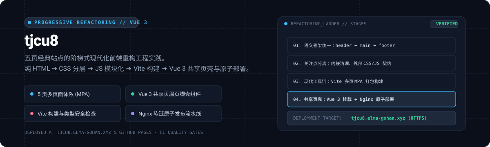

# tjcu8

<div align="center">
  
</div>

<p align="center">
  <a href="https://tjcu8.elma-gohan.xyz/"><strong>独立域名演示 (tjcu8.elma-gohan.xyz)</strong></a> ·
  <a href="#渐进式重构路径"><strong>重构演进路径</strong></a> ·
  <a href="#常用命令与构建契约"><strong>构建契约</strong></a> ·
  <a href="#双端部署与原子发布"><strong>生产部署</strong></a> ·
  <a href="#工程资料索引"><strong>文档导航</strong></a>
</p>

---

tjcu8 是一个采用 Vite 作为现代化工具链、基于 Vue 3 统一承载共享页眉页脚壳（Shared Page Shell）的多页面（MPA）前端渐进式重构工程实践。

项目记录了一套经典五页静态网站从最初的粗糙单文件形式，一步步演化至现代工程化规范的完整过程：保留原站点的玩梗文本与人格基调，以严苛的模块化与契约驱动思维重构代码底座。

---

## 渐进式重构路径

重构过程遵循严格的由浅入深演进阶梯（详见 [`docs/refactoring-progress.md`](docs/refactoring-progress.md)）：

1. **第一阶段：语义骨架与单页收敛**
   - 确立唯一的正式首页为 `index.html`，纠正全站跳转；
   - 统一全站五个页面的 `header ➔ main ➔ footer` 语义化标签拓扑结构。
2. **第二阶段：关注点分离与资源契约**
   - 彻底剔除内联 `<style>`，样式集中归口至分层 CSS；
   - 剥离内联 JavaScript 逻辑，沉淀独立脚本模块；
   - 制定图片索引 JSON 契约 v1，编写 Python 生成器与配套前端检查器。
3. **第三阶段：响应式与无障碍访问 (A11y)**
   - 建立 768px 移动端断点，适配移动与桌面双端视口；
   - 全站页面统一主导航契约，引入合规的 `aria-current` 路由标记与图片替代文本。
4. **第四阶段：现代工具链与组件化共享壳**
   - 引入 Vite 作为打包工具链，配置多页面（MPA）生产构建；
   - 引入 Vue 3 挂载统一的共享页眉与页脚壳组件，兼顾开发效率与静态交付。

---

## 常用命令与构建契约

开发环境要求：Node.js $\ge 18$。

```bash
npm ci              # 依据 lockfile 干净安装依赖
npm run dev         # 启动 Vite 本地开发热重载服务器
npm run build       # 执行生产环境静态打包构建
npm run check:dist  # 检查产物完整性与引用契约
```

构建合同与工具链配置细节详见 [`docs/vite-toolchain.md`](docs/vite-toolchain.md)。

---

## 双端部署与原子发布

- **GitHub Pages 自动化门禁**：通过 GitHub Actions 联动，代码提交触发规范检查与静态发布；
- **阿里云服务器原子发布**：
  - 部署于独立域名 <https://tjcu8.elma-gohan.xyz/>（配置 Let's Encrypt 证书自动续期）；
  - 采用 Nginx 版本软链（`current` 符号链接原子替换）发布机制，支持秒级无感切换与快速回滚，物理隔离于服务器承载的其他根域名站点。

---

## 工程资料索引

- [前端渐进式重构全景手稿 (docs/refactoring-progress.md)](docs/refactoring-progress.md)
- [Vite 工具链与构建契约 (docs/vite-toolchain.md)](docs/vite-toolchain.md)
- [服务器隔离部署与运维记录 (docs/aliyun-deployment.md)](docs/aliyun-deployment.md)